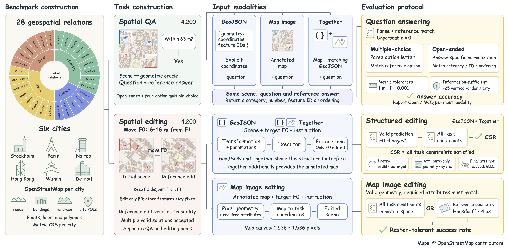

# GeoSpatialBench

<p align="center">
  <a href="https://arxiv.org/abs/2610.12881"></a>
  <a href="https://geospatialbench.kgtx.cloud/"></a>
  <a href="LICENSE"></a>
</p>

GeoSpatialBench evaluates **28 spatial relations** through **Open QA, four-option MCQ and Editing**, with **GeoJSON, Image and Together** inputs.

<p align="center">
  <a href="docs/images/pipeline.png">
    
  </a>
</p>

This release includes the fixed Stockholm case: 700 QA scenes, 700 independent Editing tasks, reference answers, Qwen3.5-9B predictions and source vectors.

<p align="center">
  <a href="docs/DATA_CONTRACT.md">Data specification</a> · <a href="docs/PROTOCOL.md">Benchmark protocol</a>
</p>

## Quickstart

Use Python 3.10+. We recommend managing your environment with `.venv` or Conda/Miniconda. From the repository root, install dependencies and score the included predictions:

```sh
python -m pip install -r requirements.txt
python scripts/evaluate.py
```

This scores the included predictions locally, without an API key or model requests. Results are written to `outputs/stockholm_example/`.

| Qwen3.5-9B · Stockholm · GeoJSON | Correct / total | Score |
|---|---:|---:|
| Open QA | 309/700 | 44.14% |
| MCQ | 316/700 | 45.14% |
| Editing, strict CSR | 266/700 | 38.00% |

## Evaluate a model

### 1. Prepare inputs

```sh
python scripts/prepare_inputs.py --out outputs/preview --per-relation 1 --mode all
```

This uses the fixed case, selects 28 QA scenes and 28 Editing tasks, copies matching references to `outputs/preview/case/`, and emits nine prompt files under `outputs/preview/prompts/`. Maps are rendered automatically for Image/Together.

- `--case PATH`: use a generated case instead of the fixed case.
- `--mode`: `geojson_exact` (default), `map_annotated`, `hybrid_geojson_exact`, or `all`.
- `--per-relation 0`: use all 700 scenes per task; the default.
- `--task qa` or `--task editing`: prepare only one task family.

For optional basemaps, set `GEOAPIFY_API_KEY` ([register](https://myprojects.geoapify.com/)) or `STADIA_API_KEY` ([register](https://client.stadiamaps.com/signup/)) in `.env`; `.env.example` provides the template. Scripts load it automatically, without overriding existing environment variables.

```sh
python scripts/prepare_inputs.py --out outputs/geoapify_preview \
  --task qa --mode all --per-relation 1 --basemap geoapify
```

Use `--basemap stadia` for Stadia, or `none` (default) to stay offline. Basemap Editing requires newly generated tasks with `source_frame`; the fixed Editing case has no recorded geographic origin. Stadia uses `static_cacheable` (2,000 credits per new background). [Basemap options and usage terms](docs/PROTOCOL.md#optional-basemaps).

### 2. Run inference

```sh
python scripts/run_inference.py \
  --prompts outputs/preview/prompts/geojson_exact/qa_open_geojson_exact.jsonl \
  --out outputs/predictions/qa_open.jsonl \
  --model YOUR_MODEL --base-url YOUR_API_ROOT --dry-run
```

`--dry-run` validates requests locally. To run inference, set `MODEL_API_KEY` in `.env` or your shell and remove that flag. Use `--resume` to continue with unchanged inputs and settings. The runner saves raw responses and retry history; `--api-format responses` selects a Responses endpoint instead of Chat Completions.

Each file covers one task form and one modality. The preview needs 28 requests per file, or 252 across all nine before retries; full inputs need 700 per file, or 6,300 across all nine.

### 3. Score predictions

```sh
python scripts/evaluate.py --case outputs/preview/case \
  --predictions outputs/predictions/qa_open.jsonl --task qa_open \
  --out outputs/reports/qa_open
```

Use `--task qa_mcq4` or `--task editing` for the other forms. To score all three, pass a directory containing `qa_open.jsonl`, `qa_mcq4.jsonl` and `editing.jsonl`, and omit `--task`.

Set `--mode` to the modality used for inference. Image-only Editing uses `map_annotated` and a [raster-tolerant metric](docs/PROTOCOL.md#offline-images-and-raster-editing) distinct from strict CSR. Missing predictions are rejected unless `--allow-partial` counts them as failures. Reports include per-item details and full-denominator scores.

Default Image/Together inputs use `offline_metric_v1`, not the paper's OSM-basemap condition. Optional basemaps are recorded as a separate renderer. Geometry-only QA omits O06 layer attributes; reports also include information-sufficient subsets.

## Generate data

```sh
python scripts/generate_data.py --out outputs/stockholm
```

The bundled vectors produce 700 QA scenes, Open/MCQ gold and 700 independent Editing tasks. New scenes use `STODEMO` IDs and require matching predictions. Output directories must be new or empty.

Use `--task qa` or `--task editing` for one task family. Editing defaults to 25 tasks per relation; `--editing-per-relation` changes that quota.

For another city:

```sh
python scripts/inspect_data.py local_data/city.gpkg
python scripts/configure_city.py --data local_data/city.gpkg \
  --city "My City" --id-prefix CITY --out configs/my_city.json
python scripts/validate_data.py --config configs/my_city.json
python scripts/generate_data.py --config configs/my_city.json
```

Review layers, field mappings, filters, a metre-based projected CRS and `output_dir`. Config paths resolve against the config directory; `generate_data.py --out` resolves against the working directory.

## Scripts and files

The main workflow uses `generate_data.py`, `prepare_inputs.py`, `run_inference.py` and `evaluate.py` under `scripts/`. Each accepts `--help`. Additional tools:

- `inspect_data.py`: list source layers, CRS and fields.
- `configure_city.py`: create an editable city configuration.
- `validate_data.py`: check source inputs with `--config`, or reference answers with `--case`.
- `render_maps.py --case PATH`: render maps without preparing prompts.

Both map-producing scripts accept `--basemap`, `--basemap-style`, `--basemap-zoom` and `--basemap-cache`. `render_maps.py --dry-run` estimates downloads and credits without making requests. Rendering prints scene and download progress; rerunning reuses completed downloads and images.

```text
scripts/          Task entry scripts
src/              Shared implementation, with qa/ and editing/ modules
configs/          City configuration templates
data/stockholm/   Fixed benchmark, model predictions and source vectors
docs/             Data requirements and benchmark protocol
```

Generated results belong in `outputs/`.

## Licensing

Code uses [MIT](LICENSE). Stockholm geographic data: **© OpenStreetMap contributors**, [ODbL 1.0](https://opendatacommons.org/licenses/odbl/1-0/). Preserve attribution when redistributing data or maps.

## Citation

```bibtex
@misc{ren2026mindspatialgap,
  title={Mind the Spatial Gap: A Benchmark for Geospatial Reasoning and Constrained Spatial Editing},
  author={Ren, Zheng and Wang, Yanning and Huang, Ziheng and Huang, Fei and Wang, Shiqi and Ye, Ziqian and Yue, Yang},
  year={2026},
  eprint={2610.12881},
  archivePrefix={arXiv},
  primaryClass={cs.AI},
  url={https://arxiv.org/abs/2610.12881}
}
```
